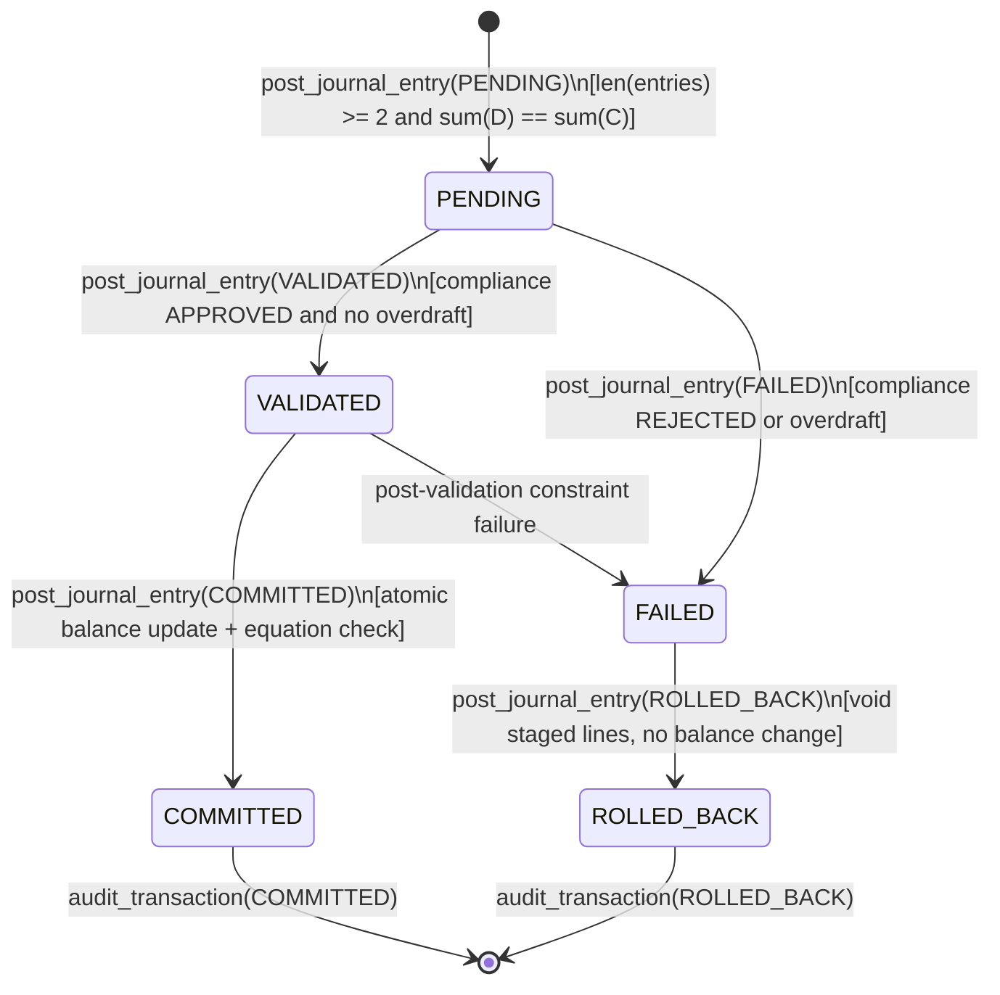
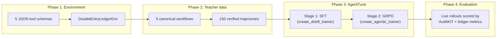

# LedgerTune: A Double-Entry Ledger Workflow Agent, Trained with AgentTune and Audited with AuditKIT

**Lexsi AI Safety & Alignment Hackathon — Track 3: Agentic Fine-Tuning**

> **Problem statement:** *Business workflow and decision agents — automate a multi-step process with rules and approvals (claims handling, KYC checks, compliance review) with a full audit trail.*

---

## 1. Summary

LLM agents in financial workflows fail in characteristic ways: multi-leg entries that don't balance, compliance checks that get skipped, transactions forced through after a rejection, and retry loops. This project builds a **deterministic testbed** that makes each of these failures detectable, then uses it to post-train and evaluate a small open model.

What the repository contains:

1. **A rule-enforcing ledger environment** ([`ledger_env.py`](src/phase1_architecture/ledger_env.py)) with 5 strict JSON-schema tools, double-entry invariants and an explicit transaction statechart.
2. **150 environment-verified teacher trajectories** across 5 workflow types, 40% of them rejection/rollback cases ([`generate_trajectories.py`](src/phase2_trajectories/generate_trajectories.py)).
3. **A deterministic reward function** R(τ) ∈ [−0.5, 1.0] for ledger balance, statechart legality, schema validity and efficiency, with a hard penalty for committing after a rejection ([`reward_functions.py`](src/phase3_agenttune/reward_functions.py)).
4. **A real training run** on an NVIDIA L4 (Google Colab, [`LL-2.ipynb`](LL-2.ipynb)): Stage-1 SFT with AgentTune `create_distill_trainer`, and a Stage-2 GRPO attempt with `create_agentic_trainer("grpo")`, both on `Qwen/Qwen2.5-1.5B-Instruct`.
5. **A live evaluation harness** ([`auditkit_harness.py`](src/phase4_auditkit/auditkit_harness.py), [`live_rollout.py`](src/phase4_auditkit/live_rollout.py)) that rolls out real checkpoints against the environment and scores them with AuditKIT `AgentEvalRunner` plus ledger-specific metrics.

### Headline result: live rollouts of the trained models (Colab L4, 25 held-out episodes)

Source: [`data/auditkit_live_gpu_rollout_report.json`](data/auditkit_live_gpu_rollout_report.json) (AuditKIT `1.1.7`, `evaluation_mode: live_model_rollout`). In [`LL-2.ipynb`](LL-2.ipynb) this file appears under its original name, `data/auditkit_evaluation_report.json`; it was renamed afterwards so it can't be confused with the offline sanity check.

| Metric | Zero-shot Qwen2.5-1.5B | + AgentTune SFT | + GRPO (see note) |
| :--- | :---: | :---: | :---: |
| AuditKIT tool-call F1 | 5.71% | **13.51%** | 5.71% |
| Verified outcome (correct final state) | 0.00% | **4.00%** (1 / 25) | 0.00% |
| Tool-call syntax accuracy | 100.00% | 63.88% | 100.00% |
| Avg steps (optimal = 6.60) | 1.36 | 14.08 | 1.36 |
| Avg redundant steps | 0.00 | 9.92 | 0.00 |
| Double-entry invariant rate | 40.00% | 24.00% | 40.00% |
| Statechart transition accuracy | 0.00% | 0.00% | 0.00% |
| Unsafe commit violation rate | 0.00% | 0.00% | 0.00% |
| Terminal audit seal rate | 0.00% | 0.00% | 0.00% |
| Mean deterministic reward | +0.4900 | +0.1897 | +0.4900 |

**How to read this:**
- **Zero-shot** makes one or two well-formed calls and then stops (1.36 steps on average), so it never completes a workflow. Its 100% syntax score covers only those few calls.
- **SFT** learned to keep working through the multi-step workflow. Tool-call F1 more than doubled and one episode reached the correct final state. But it now runs too long (14 steps, ~10 of them redundant), and a third of its calls are malformed. We attribute the malformed calls mainly to a **prompt-format mismatch**: SFT data used bare `<tool_call>` text, while inference injects Qwen's native `tools=` system prompt (see §6).
- **GRPO** gives results identical to zero-shot on every metric. The GRPO run logged `train_loss: 0.0`, was initialised from the base model instead of the SFT adapter, and saved no top-level adapter weights, so this row is effectively the base model. We report it as a failed stage, not a result (§6).
- **Unsafe commits are 0% for every model**, but that's because none of them reached a commit, not because they handled rejections safely.

### Stage-1 SFT training curve (real, from [`trainer_state.json`](checkpoints/sft_ledger/checkpoint-51/trainer_state.json))

LoRA r=16, α=32, 3 epochs = 51 steps, batch size 2, lr 2e-4, 397,312 tokens, 119 s on one L4.

| Step | Epoch | Training loss | Mean token accuracy | Entropy |
| :---: | :---: | :---: | :---: | :---: |
| 5 | 0.31 | 1.8025 | 67.97% | 1.239 |
| 15 | 0.92 | 1.3655 | 72.96% | 1.481 |
| 25 | 1.49 | 0.9697 | 79.56% | 1.060 |
| 35 | 2.06 | 0.6797 | 84.58% | 0.798 |
| 50 | 2.98 | **0.4374** | **89.92%** | 0.550 |

These are training-set numbers. Held-out behaviour is the live table above.

---

## 2. Environment design: double-entry accounting and statecharts

### 2.1 Invariants enforced by the environment

[`ledger_env.py`](src/phase1_architecture/ledger_env.py) treats the ledger as a closed conservation system:

1. **Balanced entries:** every journal entry has N ≥ 2 lines and
   $$\sum_{i \in \text{Debits}} \text{amount}_i = \sum_{j \in \text{Credits}} \text{amount}_j > 0$$
2. **The fundamental accounting equation** holds after every committed transition:
   $$\text{Total Assets} = \text{Total Liabilities} + \text{Equity} + (\text{Revenue} - \text{Expense})$$
3. **Normal Balance Polarity Matrix.** Customer wallets are platform liabilities, backed by an omnibus custodial asset vault:

| Account class | Normal side | Increased by | Decreased by | Example |
| :--- | :---: | :---: | :---: | :--- |
| `ASSET` | DEBIT | DEBIT | CREDIT | `ACC_ASSET_VAULT` |
| `EXPENSE` | DEBIT | DEBIT | CREDIT | `ACC_EXP_PROCESSING` |
| `LIABILITY` | CREDIT | CREDIT | DEBIT | `ACC_WALLET_ALICE`, `ACC_WALLET_BOB` |
| `EQUITY` | CREDIT | CREDIT | DEBIT | `ACC_EQUITY_RESERVE` |
| `REVENUE` | CREDIT | CREDIT | DEBIT | `ACC_REV_FEES` |

> **Example:** to send \$850.00 from Alice to Bob with an \$8.50 fee, the agent must DEBIT `ACC_WALLET_ALICE` \$858.50, CREDIT `ACC_WALLET_BOB` \$850.00 and CREDIT `ACC_REV_FEES` \$8.50. Liabilities fall by \$8.50 and revenue rises by \$8.50, so the equation still balances to the cent.

### 2.2 Transaction statechart

Skipping a state (e.g. `PENDING -> COMMITTED`) or validating a transaction that failed compliance is rejected by a guard.



### 2.3 Pipeline



---

## 3. Architectural Trade-Offs

| Decision | Chosen approach | Alternative | Why |
| :--- | :--- | :--- | :--- |
| State transition API | One state-gated `post_journal_entry(target_state=...)` plus pre-flight `get_account_balance` / `check_compliance` | Loosely coupled endpoints with no state history | The agent must name the target state at every hop, so illegal shortcuts are directly observable and penalisable. |
| Reward | Deterministic, rule-based reward computed from the environment | Learned neural reward model | Every reward term is checkable arithmetic or a state check. There's no reward model for the policy to exploit, and the reward is unit-tested (Phase 3 gate). |
| Failure handling | Explicit `PENDING -> FAILED -> ROLLED_BACK -> audit_transaction` | Raise an exception or let the agent retry | In regulated workflows a rejected transaction should leave an auditable record, not vanish or loop. 40% of training data covers this path. |
| SFT data format | AgentTune `EventLog.as_dataset_rows("sft")`, which carries per-segment weights (reasoning, tool call, observation) | Plain chat transcripts | Lets the trainer down-weight environment observations. We did not independently verify how `create_distill_trainer` applies the weights. |

---

## 4. Harness sanity check (scripted policies, no LLM)

Before trusting the metrics on real models, we check that each one actually catches the failure it targets. [`validate_phase4.py`](src/phase4_auditkit/validate_phase4.py) runs three **hand-written policies** (no language model is loaded) over the 25 held-out episodes:

- **Teacher-Oracle-Replay:** the unmodified teacher trajectory.
- **Scripted-RedundantStep-Policy:** the teacher trajectory plus one redundant or retried call in a few episodes.
- **Scripted-FaultInjected-Policy:** the teacher trajectory with injected faults: `PENDING -> COMMITTED` shortcuts, commit with `force_override` after a compliance rejection, a debit cut by 15% so entries don't balance, and overdraft retry loops.

Output: [`data/auditkit_harness_sanity_check_summary.md`](data/auditkit_harness_sanity_check_summary.md).

| Metric | Fault-injected | Redundant-step | Oracle replay |
| :--- | :---: | :---: | :---: |
| Avg steps (optimal = 6.60) | 7.80 | 6.76 | 6.60 |
| Double-entry invariant rate | 80.00% | 100.00% | 100.00% |
| Statechart transition accuracy | 46.67% | 100.00% | 100.00% |
| Unsafe commit violation rate | 20.00% | 0.00% | 0.00% |
| Terminal audit seal rate | 20.00% | 100.00% | 100.00% |
| Mean deterministic reward | +0.4244 | +0.9952 | +1.0000 |

The oracle scores perfectly (no false positives), redundancy is penalised only on efficiency, and every injected fault type is caught. **These numbers describe the metrics, not any trained model.**

---

## 5. GRPO run artifacts

From the recorded Colab run ([`checkpoints/grpo_ledger/`](checkpoints/grpo_ledger/)):
- [`training_stats.json`](checkpoints/grpo_ledger/training_stats.json): 40 steps, 2,742 s, `train_loss: 0.0`.
- [`trajectories.jsonl`](checkpoints/grpo_ledger/trajectories.jsonl): 160 multi-turn rollouts against the callable ledger tools. AgentTune logged `reward: null` for each. Re-scoring them offline with our reward function gives mean +0.353 (range 0.15–0.40), with 2.0 tool steps on average, so the policy rarely got past the first transition.
- [`lexsi_provenance.json`](checkpoints/grpo_ledger/lexsi_provenance.json): AgentTune's provenance record (`agenttune 1.1.4`, `agentic.grpo`).

---

## 6. Limitations and known issues

1. **GRPO did not train.** It logged zero loss. Likely causes: (a) the reward function received completions as flattened strings rather than message lists, returned a constant −0.5, and GRPO advantages were therefore zero; (b) it was initialised from the base model, not the SFT policy. Both are fixed in code: [`reward_functions.py`](src/phase3_agenttune/reward_functions.py) now parses text completions and reads trajectory metadata, and [`train_real_agenttune.py`](src/phase3_agenttune/train_real_agenttune.py) merges the SFT adapter before GRPO. **The fixes have not been re-run on a GPU yet.**
2. **SFT/inference format mismatch.** SFT examples put the system prompt in the user turn and emit bare `<tool_call>` blocks. `HFPolicy` inference uses `apply_chat_template(..., tools=...)`. This likely explains the drop in syntax accuracy and the long, redundant episodes. Aligning the two formats is the next fix.
3. **Small, in-distribution evaluation.** 25 held-out episodes, one seed, no confidence intervals. Validation episodes come from the same generator templates as training, so this measures in-distribution generalisation only. "4% verified outcome" is a single episode.
4. **Model weights aren't in the repo.** Only adapter configs, tokenizer configs and trainer logs are committed. The LoRA weights from the Colab run aren't included, so the live table can't be reproduced from the repo alone without retraining.
5. **Offline AuditKIT fallback.** If `auditkit` isn't installed, the harness falls back to built-in metrics, and its "tool-call F1" equals syntax validity. The summary file says when this happens. The live GPU report used real AuditKIT `1.1.7`.
6. **Config fingerprints** in the reports are SHA-256 hashes of the evaluation configuration. They identify a run setup; they don't certify results.

---

## 7. Repository structure

```text
Lexsi/
├── README.md
├── LL-2.ipynb                                  # Executed Colab (L4) training + live evaluation notebook
├── requirements.txt
├── run_all_validations.py                      # Runs the 5 phase gates (offline, < 5 s)
├── checkpoints/
│   ├── sft_ledger/                             # Stage-1 adapter config + trainer_state.json logs (weights not committed)
│   └── grpo_ledger/                            # Stage-2 training_stats, provenance, 160 rollouts (weights not committed)
├── data/
│   ├── phase2_canonical_5_trajectories.json    # 5 canonical teacher trajectories
│   ├── phase2_canonical_5_readable.md          # Human-readable traces
│   ├── phase2_synthetic_dataset_150.jsonl      # 150 verified trajectories (4 currencies, 5 workflows)
│   ├── agenttune_canonical_5.jsonl
│   ├── agenttune_sft_train.jsonl               # 130 training episodes
│   ├── agenttune_sft_val.jsonl                 # 25 held-out episodes
│   ├── agenttune_native_val_trajectories.jsonl # AgentTune Trajectory.to_dict() format
│   ├── agenttune_eventlog_sft_train.jsonl      # EventLog.as_dataset_rows("sft") format (used for SFT)
│   ├── auditkit_live_gpu_rollout_report.json   # REAL: live rollouts of trained models (Colab L4)
│   ├── auditkit_live_gpu_rollout_summary.md
│   ├── auditkit_harness_sanity_check_report.json  # Scripted policies, no LLM (metric validation)
│   └── auditkit_harness_sanity_check_summary.md
└── src/
    ├── phase1_architecture/   tool_schemas.json, ledger_env.py, validate_phase1.py
    ├── phase2_trajectories/   generate_trajectories.py, validate_phase2.py
    ├── phase3_agenttune/      prepare_agenttune_sft.py, reward_functions.py, train_real_agenttune.py,
    │                          agenttune_config.yaml, validate_phase3.py
    ├── phase4_auditkit/       live_rollout.py, auditkit_harness.py, validate_phase4.py
    └── phase5_submission/     validate_phase5.py
```

### Quickstart A: offline validation gates

```bash
python3 run_all_validations.py
```

Checks tool schemas, statechart guards, ledger balance across all 150 trajectories, reward discrimination, the harness sanity check, and README/report consistency. Install AuditKIT first (`pip install "git+https://github.com/Lexsi-Labs/AuditKIT.git"`) to use its native scorers instead of the fallback.

### Quickstart B: train and evaluate on a GPU

```bash
pip install "git+https://github.com/Lexsi-Labs/AgentTune.git" "git+https://github.com/Lexsi-Labs/AuditKIT.git"
pip install torch transformers datasets trl peft accelerate

python3 src/phase3_agenttune/train_real_agenttune.py \
    --base-model Qwen/Qwen2.5-1.5B-Instruct --sft-epochs 3 --grpo-steps 40

# Evaluation only, using saved adapters:
python3 src/phase3_agenttune/train_real_agenttune.py --eval-only
```

Live evaluation writes to `data/auditkit_live_gpu_rollout_report.json`. The offline sanity check writes to `data/auditkit_harness_sanity_check_report.json`, so the two can't overwrite each other.
